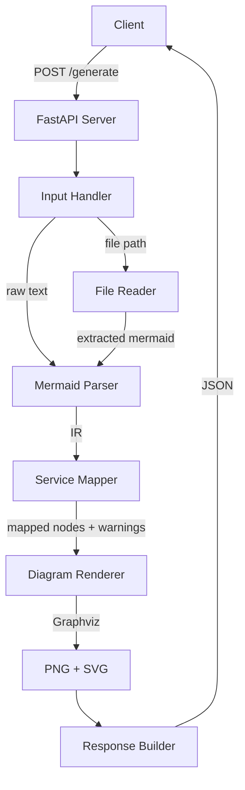
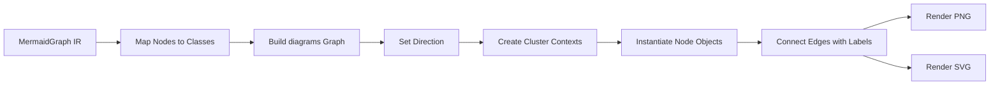

# Design Document: AWS Architecture Diagram Generator

## Overview

The AWS Architecture Diagram Generator is a Python REST API service that converts Mermaid graph syntax into visual architecture diagrams using official AWS icons. The system accepts either a file path to a Markdown document containing a Mermaid code block, or raw Mermaid text, and produces PNG and SVG outputs rendered via the `diagrams` library and Graphviz.

The system is composed of three core components:
1. **API Server** — A FastAPI application exposing endpoints for diagram generation
2. **Mermaid Parser** — A regex-based parser that converts Mermaid graph syntax into a structured intermediate representation (IR)
3. **Diagram Renderer** — A pipeline that maps parsed nodes to `diagrams.aws.*` classes and renders output using Graphviz

### Key Design Decisions

| Decision | Rationale |
|----------|-----------|
| FastAPI over Flask | Native async support, automatic OpenAPI docs, Pydantic validation built-in |
| Custom Mermaid parser over third-party library | Existing Python Mermaid parsers are immature or bring heavy JS dependencies; our grammar subset is well-defined and limited to graph diagrams |
| Static mapping + dynamic fallback for AWS services | Covers the most common services instantly while remaining extensible for the full `diagrams.aws` provider tree |
| Intermediate representation as dataclasses | Enables testing the parser independently from the renderer; supports the round-trip serialization property |

## Architecture



### Component Interaction Flow

1. Client sends a POST request with either `file_path` or `mermaid_text`
2. Input Handler validates the request and routes to File Reader or directly to Mermaid Parser
3. Mermaid Parser produces an intermediate representation (IR) of nodes, edges, and clusters
4. Service Mapper resolves each node label to a `diagrams.aws.*` class, collecting warnings for ambiguous/unknown nodes
5. Diagram Renderer constructs the `diagrams` library graph and invokes Graphviz to produce PNG and SVG
6. Response Builder returns a consistent JSON response with file paths (or binary content) and any warnings

## Components and Interfaces

### 1. API Server (`app/api/`)

**Framework:** FastAPI 0.100+  
**Responsibilities:** Request validation, routing, response formatting, error handling middleware

#### Endpoints

| Method | Path | Description |
|--------|------|-------------|
| POST | `/generate` | Accept Mermaid input and return generated diagrams |

#### Request Models

```python
from pydantic import BaseModel, model_validator
from typing import Optional


class GenerateRequest(BaseModel):
    """Request body for diagram generation endpoint."""

    file_path: Optional[str] = None
    mermaid_text: Optional[str] = None

    @model_validator(mode="after")
    def validate_at_least_one_input(self) -> "GenerateRequest":
        """Ensure at least one input source is provided."""
        if not self.file_path and not self.mermaid_text:
            raise ValueError(
                "Either 'file_path' or 'mermaid_text' must be provided"
            )
        return self
```

#### Response Models

```python
from pydantic import BaseModel
from typing import Optional, List


class WarningEntry(BaseModel):
    """A warning about node mapping during diagram generation."""

    node_label: str
    reason: str
    selected_service: Optional[str] = None
    alternatives: Optional[List[str]] = None


class GenerateData(BaseModel):
    """Successful generation result data."""

    files: List[str]


class GenerateResponse(BaseModel):
    """Standard API response envelope."""

    status: str  # "success" or "error"
    data: Optional[GenerateData] = None
    warnings: List[WarningEntry] = []
    message: Optional[str] = None
```

---

### 2. Input Handler (`app/input_handler.py`)

**Responsibilities:** Read Markdown files, extract Mermaid code blocks, validate input availability

#### Interface

```python
import re
from pathlib import Path


MERMAID_BLOCK_PATTERN = re.compile(
    r"```mermaid\s*\n(.*?)```",
    re.DOTALL
)


def extract_mermaid_from_file(file_path: str) -> str:
    """Read a Markdown file and extract the first Mermaid code block.

    Args:
        file_path: Absolute or relative path to the Markdown file.

    Returns:
        The raw Mermaid text inside the first fenced code block.

    Raises:
        FileNotFoundError: If the file does not exist or is not readable.
        ValueError: If no Mermaid code block is found in the file.
    """
    ...


def extract_mermaid_from_text(mermaid_text: str) -> str:
    """Validate and normalize raw Mermaid text input.

    Args:
        mermaid_text: Raw Mermaid diagram syntax.

    Returns:
        Cleaned Mermaid text ready for parsing.

    Raises:
        ValueError: If the text is empty or contains no graph declaration.
    """
    ...
```

---

### 3. Mermaid Parser (`app/parser/`)

**Responsibilities:** Parse Mermaid graph syntax into a structured intermediate representation

#### Design Approach

The parser uses a two-phase strategy:
1. **Lexical phase** — Regex-based tokenization of Mermaid syntax elements (direction declaration, node definitions, edge connections, subgraph boundaries)
2. **Structural phase** — Build the IR tree by processing tokens sequentially, tracking subgraph nesting via a stack

This avoids the overhead of a full grammar parser (like ANTLR or lark) while correctly handling the subset of Mermaid syntax we support (graph diagrams with subgraphs, labeled edges, and various node shapes).

#### Supported Syntax

| Mermaid Element | Pattern | Example |
|-----------------|---------|---------|
| Direction | `graph (TD\|LR\|TB\|RL)` | `graph TD` |
| Node (simple) | `id[label]` or `id(label)` or bare `id` | `Lambda[AWS Lambda]` |
| Edge (arrow) | `A --> B` | `Client --> APIGateway` |
| Edge (labeled) | `A -->\|label\| B` | `API -->\|REST\| Lambda` |
| Edge (dotted) | `A -.-> B` | `Lambda -.-> DynamoDB` |
| Subgraph | `subgraph Name ... end` | `subgraph VPC ... end` |

#### Interface

```python
from dataclasses import dataclass, field
from typing import List, Optional


@dataclass
class MermaidNode:
    """A node in the Mermaid graph."""

    id: str
    label: str


@dataclass
class MermaidEdge:
    """A directed edge between two nodes."""

    source_id: str
    target_id: str
    label: Optional[str] = None
    style: str = "solid"  # "solid", "dotted", "thick"


@dataclass
class MermaidCluster:
    """A subgraph grouping of nodes."""

    name: str
    node_ids: List[str] = field(default_factory=list)
    children: List["MermaidCluster"] = field(default_factory=list)


@dataclass
class MermaidGraph:
    """Complete intermediate representation of a parsed Mermaid graph."""

    direction: str  # "TD", "LR", "TB", "RL"
    nodes: List[MermaidNode] = field(default_factory=list)
    edges: List[MermaidEdge] = field(default_factory=list)
    clusters: List[MermaidCluster] = field(default_factory=list)

    def serialize(self) -> str:
        """Serialize the IR back to valid Mermaid syntax.

        Returns:
            A string of valid Mermaid graph syntax representing this IR.
        """
        ...


def parse_mermaid(text: str) -> MermaidGraph:
    """Parse Mermaid graph syntax into a structured IR.

    Args:
        text: Raw Mermaid graph syntax (without fencing).

    Returns:
        A MermaidGraph object containing all parsed elements.

    Raises:
        MermaidSyntaxError: If the text contains invalid syntax,
            with location and nature of the error.
    """
    ...
```

---

### 4. Service Mapper (`app/mapper/`)

**Responsibilities:** Map Mermaid node labels to `diagrams.aws.*` classes; report warnings for ambiguous/missing mappings

#### Mapping Strategy

The mapper uses a two-tier resolution approach:

**Tier 1 — Static Mapping Table**  
A dictionary of normalized service names to their `diagrams.aws.*` import paths. Covers the minimum required services and common aliases:

```python
STATIC_SERVICE_MAP: dict[str, str] = {
    "apigateway": "diagrams.aws.network.APIGateway",
    "cognito": "diagrams.aws.security.Cognito",
    "kms": "diagrams.aws.security.KMS",
    "secretsmanager": "diagrams.aws.security.SecretsManager",
    "lambda": "diagrams.aws.compute.Lambda",
    "ecs": "diagrams.aws.compute.ECS",
    "stepfunctions": "diagrams.aws.integration.StepFunctions",
    "sqs": "diagrams.aws.integration.SQS",
    "sns": "diagrams.aws.integration.SNS",
    "dynamodb": "diagrams.aws.database.Dynamodb",
    "cloudwatch": "diagrams.aws.management.Cloudwatch",
    "cloudtrail": "diagrams.aws.management.Cloudtrail",
    "xray": "diagrams.aws.devtools.XRay",
    "client": "diagrams.aws.general.Client",
    # Additional common aliases
    "ec2": "diagrams.aws.compute.EC2",
    "s3": "diagrams.aws.storage.S3",
    "rds": "diagrams.aws.database.RDS",
    "elb": "diagrams.aws.network.ELB",
    "route53": "diagrams.aws.network.Route53",
    "vpc": "diagrams.aws.network.VPC",
}
```

**Tier 2 — Dynamic Resolution**  
For labels not found in the static map, introspect all submodules of `diagrams.aws` at runtime and search for a class whose name matches after normalization.

#### Normalization Function

```python
import re


def normalize_service_name(label: str) -> str:
    """Normalize a node label for service matching.

    Performs case-insensitive comparison by lowercasing,
    then strips whitespace, hyphens, and underscores.

    Args:
        label: The raw node label from Mermaid syntax.

    Returns:
        Normalized string for lookup in service maps.
    """
    return re.sub(r"[\s\-_]", "", label.lower())
```

#### Interface

```python
from dataclasses import dataclass
from typing import Optional, List, Type


@dataclass
class MappingResult:
    """Result of mapping a single node label to a diagrams class."""

    node_id: str
    node_label: str
    diagrams_class: Type
    warning: Optional["WarningEntry"] = None


def resolve_service(node_label: str) -> tuple[Optional[Type], Optional["WarningEntry"]]:
    """Resolve a node label to a diagrams.aws class.

    Args:
        node_label: The display label of the Mermaid node.

    Returns:
        A tuple of (resolved_class, warning).
        If resolved exactly: (class, None)
        If ambiguous: (first_alphabetical_class, warning_with_alternatives)
        If unresolved: (General_class, warning_with_reason)
    """
    ...


def map_all_nodes(nodes: List["MermaidNode"]) -> List[MappingResult]:
    """Map all nodes in a graph to diagrams classes.

    Args:
        nodes: List of MermaidNode objects from the parser IR.

    Returns:
        List of MappingResult objects with resolved classes and warnings.
    """
    ...
```

---

### 5. Diagram Renderer (`app/renderer/`)

**Responsibilities:** Construct the `diagrams` library graph from the IR and mapped classes, invoke Graphviz, produce PNG and SVG output

#### Rendering Pipeline



#### Interface

```python
from pathlib import Path
from typing import Optional, List


@dataclass
class RenderResult:
    """Result of rendering a diagram."""

    png_path: Path
    svg_path: Path
    warnings: List["WarningEntry"]


def render_diagram(
    graph: "MermaidGraph",
    output_dir: Path,
    output_name: str,
    mappings: List["MappingResult"],
) -> RenderResult:
    """Render the parsed graph into PNG and SVG files.

    Args:
        graph: The parsed MermaidGraph intermediate representation.
        output_dir: Directory where output files will be saved.
        output_name: Base name for output files (without extension).
        mappings: List of node-to-class mappings from the service mapper.

    Returns:
        RenderResult with paths to generated files and any warnings.

    Raises:
        RenderError: If Graphviz fails to produce output.
    """
    ...
```

#### Rendering Details

The renderer constructs the `diagrams` library graph programmatically:

```python
from diagrams import Diagram, Cluster, Edge

# Pseudocode for rendering logic
with Diagram(
    name=output_name,
    filename=str(output_dir / output_name),
    show=False,
    direction=graph.direction,
    outformat=["png", "svg"],
    graph_attr={"dpi": "150", "size": "10.24,7.68!"},
):
    # Create node instances
    node_objects = {}
    for mapping in mappings:
        node_objects[mapping.node_id] = mapping.diagrams_class(
            mapping.node_label
        )

    # Create clusters
    for cluster in graph.clusters:
        with Cluster(cluster.name):
            for node_id in cluster.node_ids:
                # Node already instantiated; diagrams uses context
                pass

    # Connect edges
    for edge in graph.edges:
        src = node_objects[edge.source_id]
        tgt = node_objects[edge.target_id]
        if edge.label:
            src >> Edge(label=edge.label) >> tgt
        else:
            src >> tgt
```

> **Note:** The actual implementation needs to handle cluster nesting by creating nodes inside `Cluster` context managers. The pseudocode above is simplified — the real implementation will instantiate nodes within their respective cluster contexts.

---

### 6. Response Builder (`app/response.py`)

**Responsibilities:** Format all API responses into the consistent JSON envelope structure

```python
from fastapi.responses import JSONResponse, StreamingResponse


def success_response(
    data: "GenerateData",
    warnings: List["WarningEntry"],
) -> JSONResponse:
    """Build a successful HTTP 200 response.

    Args:
        data: The generation result data containing file paths.
        warnings: List of warnings from the mapping phase.

    Returns:
        JSONResponse with status="success".
    """
    ...


def error_response(
    status_code: int,
    message: str,
) -> JSONResponse:
    """Build an error response.

    Args:
        status_code: HTTP status code (4xx or 5xx).
        message: Human-readable error description.

    Returns:
        JSONResponse with status="error".
    """
    ...


def binary_response(
    png_bytes: bytes,
    svg_bytes: bytes,
    warnings: List["WarningEntry"],
) -> StreamingResponse:
    """Return diagram content directly when no file path was provided.

    For raw Mermaid text input, returns a multipart response or
    a zip archive containing both PNG and SVG files.

    Args:
        png_bytes: The rendered PNG content.
        svg_bytes: The rendered SVG content.
        warnings: List of mapping warnings.

    Returns:
        StreamingResponse with appropriate Content-Type.
    """
    ...
```

## Data Models

### Intermediate Representation (IR)

The IR is the central data structure connecting the parser and renderer. It is implemented as Python dataclasses for clarity, type safety, and ease of testing.

```python
from dataclasses import dataclass, field
from typing import List, Optional


@dataclass
class MermaidNode:
    """Represents a node in the Mermaid graph.

    Attributes:
        id: The Mermaid identifier (used in edge definitions).
        label: The display label (used for service mapping).
    """

    id: str
    label: str

    def __eq__(self, other: object) -> bool:
        """Equality based on id and label."""
        if not isinstance(other, MermaidNode):
            return NotImplemented
        return self.id == other.id and self.label == other.label

    def __hash__(self) -> int:
        """Hash based on id."""
        return hash(self.id)


@dataclass
class MermaidEdge:
    """Represents a directed edge between two nodes.

    Attributes:
        source_id: ID of the source node.
        target_id: ID of the target node.
        label: Optional text label displayed on the edge.
        style: Arrow style — "solid", "dotted", or "thick".
    """

    source_id: str
    target_id: str
    label: Optional[str] = None
    style: str = "solid"


@dataclass
class MermaidCluster:
    """Represents a subgraph grouping.

    Attributes:
        name: Display name of the cluster.
        node_ids: IDs of nodes directly contained in this cluster.
        children: Nested sub-clusters within this cluster.
    """

    name: str
    node_ids: List[str] = field(default_factory=list)
    children: List["MermaidCluster"] = field(default_factory=list)


@dataclass
class MermaidGraph:
    """Complete intermediate representation of a parsed Mermaid graph.

    This is the core data model that bridges parsing and rendering.
    It supports serialization back to Mermaid syntax for round-trip
    testing.

    Attributes:
        direction: Graph layout direction (TD, LR, TB, RL).
        nodes: All nodes declared in the graph.
        edges: All directed edges between nodes.
        clusters: Top-level cluster hierarchy (may be nested).
    """

    direction: str
    nodes: List[MermaidNode] = field(default_factory=list)
    edges: List[MermaidEdge] = field(default_factory=list)
    clusters: List[MermaidCluster] = field(default_factory=list)

    def serialize(self) -> str:
        """Serialize the IR back to valid Mermaid syntax."""
        ...

    def get_node_by_id(self, node_id: str) -> Optional[MermaidNode]:
        """Look up a node by its ID."""
        ...

    def get_cluster_for_node(self, node_id: str) -> Optional[MermaidCluster]:
        """Find which cluster (if any) contains the given node."""
        ...
```

### API Models (Pydantic)

```python
from pydantic import BaseModel
from typing import Optional, List


class GenerateRequest(BaseModel):
    """POST /generate request body."""

    file_path: Optional[str] = None
    mermaid_text: Optional[str] = None


class WarningEntry(BaseModel):
    """Warning about a node mapping issue."""

    node_label: str
    reason: str
    selected_service: Optional[str] = None
    alternatives: Optional[List[str]] = None


class GenerateData(BaseModel):
    """Successful generation result."""

    files: List[str]


class GenerateResponse(BaseModel):
    """Standard API response envelope."""

    status: str
    data: Optional[GenerateData] = None
    warnings: List[WarningEntry] = []
    message: Optional[str] = None
```

### Error Types

```python
class MermaidSyntaxError(Exception):
    """Raised when the Mermaid input contains invalid syntax.

    Attributes:
        line: Approximate line number of the error.
        column: Approximate column position.
        detail: Description of the syntax issue.
    """

    def __init__(self, line: int, column: int, detail: str) -> None:
        self.line = line
        self.column = column
        self.detail = detail
        super().__init__(
            f"Syntax error at line {line}, col {column}: {detail}"
        )


class RenderError(Exception):
    """Raised when Graphviz fails to produce diagram output.

    Attributes:
        cause: Description of the rendering failure.
    """

    def __init__(self, cause: str) -> None:
        self.cause = cause
        super().__init__(f"Rendering failed: {cause}")


class ServiceMappingError(Exception):
    """Raised for internal errors during service resolution."""

    pass
```

## Correctness Properties

*A property is a characteristic or behavior that should hold true across all valid executions of a system — essentially, a formal statement about what the system should do. Properties serve as the bridge between human-readable specifications and machine-verifiable correctness guarantees.*

### Property 1: Mermaid Code Block Extraction

*For any* Markdown file containing one or more fenced Mermaid code blocks (` ```mermaid ... ``` `) at arbitrary positions within the document, extracting the Mermaid content SHALL always return the contents of the first such code block, ignoring subsequent blocks and all surrounding Markdown content.

**Validates: Requirements 1.3**

### Property 2: Parser Completeness

*For any* valid Mermaid graph containing N nodes, M edges (with or without labels), and K subgraph clusters (possibly nested), parsing the graph SHALL produce an intermediate representation containing exactly N nodes with correct IDs and labels, exactly M edges with correct source/target IDs and labels, and exactly K clusters preserving the parent-child nesting hierarchy and node membership.

**Validates: Requirements 2.1, 2.2, 2.3, 2.6, 2.7**

### Property 3: Parser Round-Trip

*For any* valid Mermaid code block, parsing it into an IR, serializing that IR back to Mermaid syntax, and parsing the serialized output again SHALL produce an intermediate representation equivalent to the first parse result. That is: `parse(serialize(parse(input))) == parse(input)`.

**Validates: Requirements 8.1, 8.2, 8.3**

### Property 4: Parser Error Reporting

*For any* Mermaid text containing a syntax error (malformed edge syntax, unclosed subgraph, missing direction declaration, or invalid node reference), the parser SHALL raise a `MermaidSyntaxError` that includes a line number, column position, and a description of the nature of the syntax issue.

**Validates: Requirements 2.5**

### Property 5: Service Name Normalization Consistency

*For any* known AWS service name and any variation of that name produced by changing letter case, inserting whitespace, hyphens, or underscores between characters, the normalization function SHALL produce the same normalized key, and the service mapper SHALL resolve all such variations to the same `diagrams.aws.*` class.

**Validates: Requirements 3.2, 3.3**

### Property 6: Unknown Service Fallback

*For any* node label that does not match any class in the `diagrams.aws` provider hierarchy after normalization, the service mapper SHALL return the `diagrams.aws.general.General` class and produce a warning entry containing the original node label and a reason indicating no matching AWS service was found.

**Validates: Requirements 3.4, 3.7**

### Property 7: Ambiguous Match Resolution

*For any* node label that normalizes to a key matching two or more distinct classes in the `diagrams.aws` provider hierarchy, the service mapper SHALL select the class whose fully-qualified name comes first in alphabetical order and produce a warning entry listing the selected service and up to 5 alternative candidates.

**Validates: Requirements 6.1**

### Property 8: Output File Naming

*For any* valid Markdown file path with base name B (i.e., the filename without extension), the renderer SHALL produce output files named exactly `B.png` and `B.svg` in the same directory as the source file.

**Validates: Requirements 5.2**

### Property 9: Response Envelope Consistency

*For any* request to the API (valid or invalid), the response body SHALL be a valid JSON object containing at minimum the keys `status` (string), `data` (object or null), `warnings` (list), and `message` (string or null). When the HTTP status code is 200, the response body SHALL be parseable by any RFC 8259-compliant JSON parser.

**Validates: Requirements 7.1, 7.6**

### Property 10: Error Response Sanitization

*For any* internal error that occurs during processing (Graphviz crash, file system error, unexpected exception), the HTTP 500 response message SHALL NOT contain Python stack traces, internal file system paths, or dependency/library names.

**Validates: Requirements 7.4**

### Property 11: No-Mermaid Detection

*For any* Markdown file that contains no fenced Mermaid code block (regardless of other content — headings, code blocks in other languages, inline code), the extraction function SHALL raise a `ValueError` indicating no Mermaid diagram was found.

**Validates: Requirements 1.5**

## Error Handling

### Error Categories and HTTP Mapping

| Error Category | HTTP Code | Trigger | Response Behavior |
|---------------|-----------|---------|-------------------|
| Validation Error | 422 | Missing/invalid request fields | Pydantic validation error detail |
| File Not Found | 400 | File path doesn't exist | Descriptive file path error |
| No Mermaid Found | 400 | Markdown has no mermaid block | "No Mermaid diagram found" message |
| Syntax Error | 400 | Invalid Mermaid syntax | Line/column/detail from parser |
| Render Failure | 500 | Graphviz crash or timeout | Generic "rendering failed" message |
| File System Error | 500 | Output directory not writable | Generic "could not save output" message |
| Unexpected Error | 500 | Any unhandled exception | Generic server error, no internals |

### Error Handling Strategy

**Layer 1: Request Validation (FastAPI + Pydantic)**
- Pydantic model validators catch missing fields and type errors automatically
- FastAPI returns 422 with structured error detail
- No custom code needed — framework handles this

**Layer 2: Input Processing Errors**
- Caught in the endpoint handler and mapped to 400 responses
- Includes: `FileNotFoundError`, `PermissionError`, `ValueError` (no mermaid block)
- Error messages are user-facing and descriptive

**Layer 3: Processing Errors**
- `MermaidSyntaxError` → 400 with line/column/detail
- `ServiceMappingError` → 500 (internal logic failure, should not happen in production)
- These are caught at the endpoint level

**Layer 4: Rendering Errors**
- `RenderError` (Graphviz failure) → 500 with generic message
- File I/O errors during save → 500 with generic message
- No partial output files are left behind (cleanup on failure)

**Layer 5: Catch-All**
- FastAPI exception handler catches all unhandled exceptions
- Returns 500 with generic message
- Logs full traceback server-side for debugging
- Never exposes internals to the client

### Implementation Pattern

```python
from fastapi import FastAPI, Request
from fastapi.responses import JSONResponse

app = FastAPI()


@app.exception_handler(Exception)
async def global_exception_handler(
    request: Request, exc: Exception
) -> JSONResponse:
    """Catch-all handler that prevents internal details from leaking.

    Logs the full exception for debugging while returning a safe
    generic message to the client.
    """
    import logging

    logging.exception("Unhandled error during request processing")
    return JSONResponse(
        status_code=500,
        content={
            "status": "error",
            "data": None,
            "warnings": [],
            "message": "An internal error occurred. Please try again.",
        },
    )


@app.exception_handler(MermaidSyntaxError)
async def syntax_error_handler(
    request: Request, exc: MermaidSyntaxError
) -> JSONResponse:
    """Handle Mermaid syntax errors with location detail."""
    return JSONResponse(
        status_code=400,
        content={
            "status": "error",
            "data": None,
            "warnings": [],
            "message": (
                f"Mermaid syntax error at line {exc.line}, "
                f"column {exc.column}: {exc.detail}"
            ),
        },
    )
```

### Cleanup on Failure

When rendering fails partway through, any partially-created output files must be removed:

```python
import os
from pathlib import Path


def safe_render(
    graph: "MermaidGraph",
    output_dir: Path,
    output_name: str,
    mappings: list,
) -> "RenderResult":
    """Render with cleanup on failure.

    If Graphviz produces partial output before failing,
    this function removes those files before raising.
    """
    png_path = output_dir / f"{output_name}.png"
    svg_path = output_dir / f"{output_name}.svg"

    try:
        return render_diagram(graph, output_dir, output_name, mappings)
    except Exception:
        # Clean up partial output
        for path in [png_path, svg_path]:
            if path.exists():
                os.remove(path)
        raise
```

## Testing Strategy

### Testing Approach

This project uses a **dual testing approach** combining property-based tests for universal correctness guarantees and example-based unit tests for specific scenarios and integration points.

### Property-Based Testing

**Library:** [Hypothesis](https://hypothesis.readthedocs.io/) (Python's standard PBT library)  
**Configuration:** Minimum 100 examples per property test  
**Tag format:** `# Feature: aws-archit-diagram-generator, Property {N}: {title}`

Property-based tests target the pure logic components:

| Property | Component Under Test | Generator Strategy |
|----------|---------------------|-------------------|
| P1: Mermaid Block Extraction | `input_handler.extract_mermaid_from_file` | Random Markdown with embedded mermaid blocks |
| P2: Parser Completeness | `parser.parse_mermaid` | Random valid Mermaid graphs |
| P3: Parser Round-Trip | `parser.parse_mermaid` + `MermaidGraph.serialize` | Random valid Mermaid graphs |
| P4: Error Reporting | `parser.parse_mermaid` | Random invalid Mermaid syntax |
| P5: Normalization Consistency | `mapper.normalize_service_name` + `mapper.resolve_service` | Random case/delimiter variations of known services |
| P6: Unknown Service Fallback | `mapper.resolve_service` | Random strings not matching any AWS service |
| P7: Ambiguous Match Resolution | `mapper.resolve_service` | Labels matching multiple services |
| P8: Output File Naming | `renderer.render_diagram` (naming logic) | Random valid file paths |
| P9: Response Envelope | Full API endpoint | Random valid/invalid requests |
| P10: Error Sanitization | Full API endpoint | Requests triggering internal errors |
| P11: No-Mermaid Detection | `input_handler.extract_mermaid_from_file` | Random Markdown without mermaid blocks |

### Custom Hypothesis Strategies

```python
from hypothesis import strategies as st


@st.composite
def mermaid_nodes(draw):
    """Generate random Mermaid node declarations."""
    node_id = draw(st.from_regex(r"[A-Za-z][A-Za-z0-9]{0,15}", fullmatch=True))
    label = draw(st.text(min_size=1, max_size=30, alphabet=st.characters(
        whitelist_categories=("L", "N", "Zs"),
    )))
    return node_id, label


@st.composite
def mermaid_graphs(draw):
    """Generate random valid Mermaid graph syntax."""
    direction = draw(st.sampled_from(["TD", "LR", "TB", "RL"]))
    num_nodes = draw(st.integers(min_value=1, max_value=10))
    nodes = [draw(mermaid_nodes()) for _ in range(num_nodes)]
    # Generate edges between existing nodes
    # Generate optional subgraphs grouping subsets of nodes
    ...
```

### Unit Tests (Example-Based)

| Test Area | Examples |
|-----------|----------|
| Direction parsing | One test per direction (TD, LR, TB, RL) |
| Required service mappings | One test per required service (14 services) |
| HTTP status codes | 400, 422, 500 specific scenarios |
| File path edge cases | Non-existent file, unreadable file, empty file |
| Binary response mode | Raw text input returns downloadable content |

### Integration Tests

| Test Area | Scope |
|-----------|-------|
| End-to-end generation | Valid Markdown file → PNG + SVG output |
| Graphviz availability | Verify Graphviz is installed and callable |
| diagrams library loading | Verify AWS provider modules load correctly |
| File system operations | Write to output directory, handle permissions |
| API response timing | Verify 30-second timeout requirement |

### Test Organization

```
tests/
├── unit/
│   ├── test_input_handler.py
│   ├── test_parser.py
│   ├── test_mapper.py
│   ├── test_renderer.py
│   └── test_response.py
├── property/
│   ├── test_extraction_properties.py    # P1, P11
│   ├── test_parser_properties.py        # P2, P3, P4
│   ├── test_mapper_properties.py        # P5, P6, P7
│   ├── test_renderer_properties.py      # P8
│   └── test_api_properties.py           # P9, P10
├── integration/
│   ├── test_end_to_end.py
│   └── test_graphviz.py
└── conftest.py                          # Shared fixtures and strategies
```

### Running Tests

```bash
# All tests
pytest tests/ -v

# Property tests only (with 100+ examples)
pytest tests/property/ -v --hypothesis-seed=0

# Unit tests only
pytest tests/unit/ -v

# Integration tests (requires Graphviz installed)
pytest tests/integration/ -v -m integration
```
