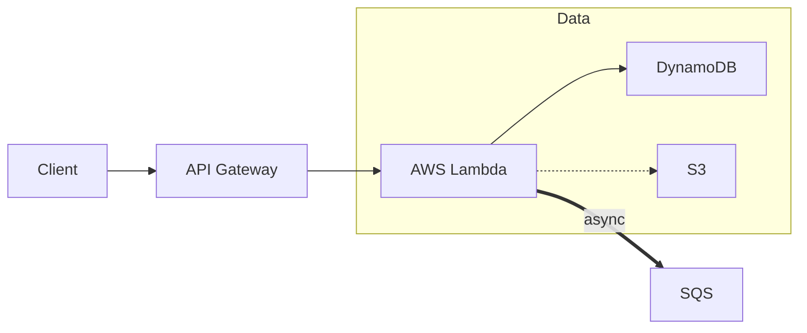

# AWS Architecture Diagram Generator

A Python REST API that converts Mermaid graph syntax into visual architecture
diagrams using official AWS icons (and icons from other providers). It parses
Mermaid, maps each node to an appropriate icon, and renders portable PNG and
SVG diagrams via Graphviz.

## Features

- Parses Mermaid `graph` and `flowchart` syntax (directions: TD, LR, TB, RL).
- Accepts input as a Markdown file (with or without a fenced ```` ```mermaid ````
  block) or as raw Mermaid text.
- Supports nodes, edges (solid `-->`, dotted `-.->`, thick `==>`, labeled
  `-->|text|`), and nested `subgraph` clusters.
- Handles quoted labels (`id["Label"]`), shape syntax (`id[("Label")]`), and
  `<br/>` line breaks in labels.
- Maps node labels to icons using a layered strategy (overrides, static map,
  dynamic introspection) with a sensible fallback.
- Recognizes non-AWS icons (GitHub, Terraform, users, etc.) and AWS ML/AI
  services (e.g. Bedrock for "agent" nodes).
- Built-in coverage for common AWS serverless services (Lambda, API Gateway,
  Step Functions, EventBridge, AppSync, SQS, SNS, DynamoDB, Kinesis, Athena,
  Aurora Serverless, and more).
- User-configurable overrides via `overrides.json`, including your own custom
  icon images.
- Produces self-contained SVGs with icons embedded as base64 (portable across
  machines and browsers).

## Prerequisites

- Python 3.10+
- **Graphviz** (system dependency required by the `diagrams` library)

### Installing Graphviz

**Windows:**
```bash
choco install graphviz
```

**macOS:**
```bash
brew install graphviz
```

**Linux (Debian/Ubuntu):**
```bash
sudo apt-get install graphviz
```

After installation, verify Graphviz is available:
```bash
dot -V
```

## Setup

1. Install the project and its dependencies:
```bash
pip install -e ".[dev]"
```

2. Run the development server (any of these work):
```bash
uvicorn app.main:app --reload
python -m app.main
python app/main.py
```

3. Run the test suite:
```bash
pytest tests/ -v
```

The interactive API docs are available at http://127.0.0.1:8000/docs.

## Usage

Send a POST request to `/generate` with a JSON body. Provide **either**
`file_path` or `mermaid_text`.

### From a file

```bash
curl -X POST http://127.0.0.1:8000/generate \
  -H "Content-Type: application/json" \
  -d '{"file_path": "C:/path/to/architecture.md"}'
```

The PNG and SVG are written next to the source file, and their paths are
returned in the response:

```json
{
  "status": "success",
  "data": { "files": ["architecture.png", "architecture.svg"] },
  "warnings": [],
  "message": null
}
```

### From raw text

```bash
curl -X POST http://127.0.0.1:8000/generate \
  -H "Content-Type: application/json" \
  -d '{"mermaid_text": "graph LR\n  A[Client] --> B[AWS Lambda]"}'
```

For raw text input the rendered files are returned as a downloadable ZIP
archive containing `diagram.png` and `diagram.svg`.

### Supported Mermaid syntax



- `graph` or `flowchart` with a direction (`TD`, `LR`, `TB`, `RL`).
- Node shapes: `id[Label]`, `id(Label)`, `id["Label"]`, `id[("Label")]`, bare `id`.
- Edges: solid `-->`, dotted `-.->`, thick `==>`, labeled `-->|text|`.
- Nested `subgraph Name ... end` clusters.
- `<br/>` (or `<br>`) inside a label renders as a line break.
- Styling directives (`classDef`, `class`, `style`, `linkStyle`) are ignored.

## Icon Resolution

Each node label is resolved to an icon using this order of precedence:

1. **Overrides** (`overrides.json`) — highest precedence; exact match wins.
2. **Static map** — curated AWS and non-AWS service names and aliases.
3. **Dynamic introspection** — searches the `diagrams.aws` hierarchy at runtime.
4. **Fallback** — `diagrams.aws.general.General` (a warning is emitted).

Matching is case-insensitive and tolerant of spaces, hyphens, underscores, and
HTML tags. Descriptive multi-word labels are also matched token by token, so
`"S3 Terraform State"` resolves to S3 and `"Risk Agent"` resolves to Amazon
Bedrock.

### Serverless coverage

The static map includes the AWS services most commonly used in serverless
architectures, so they resolve automatically without needing overrides:

| Category    | Services (examples)                                             |
|-------------|----------------------------------------------------------------|
| Compute     | Lambda, Lambda Function, Fargate                               |
| API / Sync  | API Gateway, AppSync                                           |
| Integration | Step Functions, SQS, SNS, EventBridge (Scheduler, Pipes, Rule) |
| Data        | DynamoDB, Aurora Serverless, DocumentDB, Keyspaces, Timestream |
| Analytics   | Kinesis (Data Streams / Firehose), Athena                     |
| Storage     | S3, EFS                                                       |
| Security    | Cognito                                                       |

Labels match with or without the `Amazon`/`AWS` prefix and are
case/spacing-insensitive (e.g. `"AWS Step Functions"`, `"stepfunctions"`, and
`"Step Functions"` all resolve to the same icon).

## Customizing with `overrides.json`

`overrides.json` lives in the project root (or point to it with the
`DIAGRAM_OVERRIDES_PATH` environment variable). It maps a node label to an
icon. The value can be either a diagrams class path **or** a custom image file.

```json
{
  "Manual Approval": "diagrams.programming.flowchart.Decision",
  "HUMAN REVIEW": "diagrams.aws.general.User",
  "Knowledge Graph": "diagrams.aws.database.Neptune",
  "Risk Agent": "diagrams.aws.ml.Bedrock",
  "IVC Copilot UI": "logo.png"
}
```

Notes:

- **Keys** are the node's display text (without the id/brackets). Matching is
  case-insensitive and normalized, so `"HUMAN REVIEW"` also matches
  `"Human Review"`.
- **Class paths** are any class from the `diagrams` library
  (`diagrams.aws.*`, `diagrams.onprem.*`, `diagrams.generic.*`, etc.).
- Overrides take priority over automatic matching, giving you full control.
- Invalid entries (typo'd module/class, or a missing image) are reported as a
  warning in the logs, and that node falls back to the generic icon.

### Custom icon images

You can use your own logos and icons.

1. Put image files (`.png`, `.jpg`, `.jpeg`, `.svg`, `.gif`, `.bmp`) in
   `assets/icons/` (configurable via the `DIAGRAM_ICONS_DIR` environment
   variable).
2. Reference them in `overrides.json` by filename:

```json
{
  "IVC Copilot UI": "logo.png"
}
```

The tool detects image references automatically by file extension. A bare
filename is looked up inside `assets/icons/`; a path with directories (e.g.
`"assets/brand/logo.png"`) or an absolute path is used as-is. Custom images
are embedded into the SVG output as base64, so diagrams remain fully portable.

## Project Structure

```
app/
├── __init__.py
├── main.py         # Application entry point (uvicorn runner)
├── input_handler.py# Mermaid extraction from files / raw text
├── api/            # FastAPI app, endpoints, request/response models
├── parser/         # Mermaid tokenizer, parser, and IR models
├── mapper/         # Label → icon resolution (overrides, static map, resolver)
└── renderer/       # Diagram rendering, safe render, SVG embedding
assets/
└── icons/          # Your custom icon images
overrides.json      # Optional label → icon overrides
tests/
├── conftest.py     # Shared fixtures and Hypothesis strategies
├── unit/           # Unit tests
├── property/       # Property-based tests (Hypothesis)
└── integration/    # Integration tests (require Graphviz)
```

## Environment Variables

| Variable                 | Default          | Description                                   |
|--------------------------|------------------|-----------------------------------------------|
| `DIAGRAM_OVERRIDES_PATH` | `./overrides.json` | Path to the overrides JSON file.            |
| `DIAGRAM_ICONS_DIR`      | `./assets/icons` | Directory searched for custom icon images.    |
